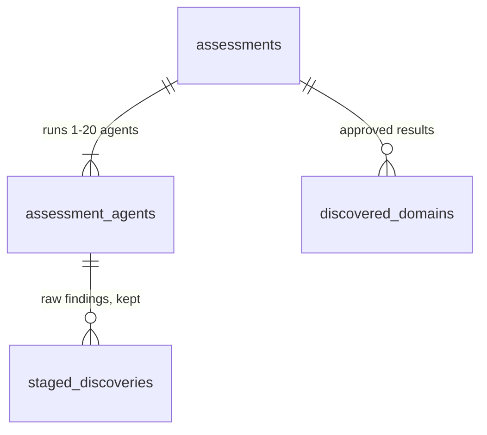

# Build plan

Everything needed to build the system, and the order to build it in. Written so a fresh session (or another
developer) can resume from this file alone. Part 1 is the build spec; part 2 is the milestones. The *why*
behind each choice is in [`decisions.md`](../decisions.md) (D1–D15), the short version in
[`tech-design.md`](tech-design.md), the picture in [`system-diagram.html`](system-diagram.html).

## Progress

| # | Milestone | Status |
|---|---|---|
| M0 | Toolchain and workspace skeleton | done |
| M1 | Deploy skeleton: `task up` on an empty cluster (R9) | not started |
| M2 | Data layer: Prisma schema and queries | not started |
| M3 | Workflow and activities (R1–R5, R7) | not started |
| M4 | HTTP API (R6) | not started |
| M5 | Web UI (R8) | not started |
| M6 | Proofs R1–R9, with outputs and videos | not started |
| M7 | `NOTES.md` and a clean-cluster dry run | not started |

Statuses: `not started` → `in progress` → `done` (its "done when" passed, reviewed, committed).

## How to work

- **One step at a time:** build, show it running, get review, then commit. Never commit unreviewed.
- **Spike first:** before relying on an external behaviour we haven't seen work, confirm it with a small spike (`spikes/`).
- **Record as you go:** a real choice → `docs/decisions.md`; an agent mistake caught → `docs/ai-log.md`; a phase change → `APPROACH.md`.
- **Never** modify `starter/agent-service/` or `starter/k8s/30-agent-service.yaml`, and never call `/admin/*` from our services (proof scripts may).
- **Pin versions** exactly: Node 22 (≥ 22.12; Alpine images), Temporal TypeScript SDK 1.26.0, Prisma 7.10.1. npm's `latest` tag for `prisma` was a release candidate.
- **Time spent:** `NOTES.md` asks for one rough total (`~Nh`), design and spikes included; keep a rough tally.

---

# Part 1 — Build spec

## 1. Repo layout

```
apps/api/            REST API (D13)
apps/worker/         Temporal worker: workflow + activities
apps/web/            Next.js app (pages + /api proxy)
packages/contracts/  zod schemas shared by api and web
packages/db/         Prisma schema, migrations, client, query functions
k8s/                 our manifests (api, worker, web, migrate Job)
proofs/              rN-*.sh, their outputs, videos/
spikes/              01–04, kept as evidence
starter/             untouched, except files the brief marks ours
Taskfile.yml
```

npm workspaces. TypeScript strict everywhere. One shared `tsconfig` base.

**Fixed names:** namespace `novee-task`; Temporal task queue `recon`; workflow type `recon`; workflow id
`assessment-<uuid>`; agent idempotency key `<uuid>-agent-<n>` (n from 0); API port 8080; web port 3000.

## 2. Data model



**Origin** below: `starter` (kept as given), `changed` (kept, with a new type or rule), `new` (ours).

### Enums

Postgres enums sort in declaration order.

| Enum | Values |
|---|---|
| `risk_level` | `LOW`, `MEDIUM`, `HIGH`, `CRITICAL` (so "most severe" is `max(risk)`) |
| `assessment_status` | `STARTING`, `RUNNING`, `AGGREGATING`, `AWAITING_APPROVAL`, `PERSISTING`, `COMPLETED`, `REJECTED`, `REJECTED_INPUT`, `CANCELLED`, `FAILED` |
| `agent_status` | `QUEUED`, `STARTING`, `RUNNING`, `COMPLETED`, `FAILED` (the agent said so), `LOST` (we gave up on it), `STOPPED` (by a cancel) |
| `lost_reason` | `START_FAILED`, `NOT_FOUND`, `NO_PROGRESS`, `CEILING` |
| `decision` | `APPROVE`, `REJECT` |

### `assessments`: one row per run

| Column | Type | Rules | Origin |
|---|---|---|---|
| `id` | `uuid` | primary key; generated by the browser (D12) | starter |
| `target_domain` | `text` | not null | starter |
| `agent_count` | `integer` | not null, 1–20 | changed |
| `window_size` | `integer` | not null, default 2, 1 to `agent_count`; updated when changed | changed |
| `status` | `assessment_status` | not null, default `STARTING` | changed |
| `stall_timeout_s` | `integer` | not null, default 60 | new |
| `max_agent_duration_s` | `integer` | not null, default 300 | new |
| `fail_first_attempts` | `integer` | not null, default 0, 0–5 (the R3 retry switch) | new |
| `cancel_requested_at` | `timestamptz` | | new |
| `decision` | `decision` | | new |
| `decision_requested_at` | `timestamptz` | | new |
| `unique_domains` | `integer` | written by `aggregate` | new |
| `critical_count`, `high_count`, `medium_count`, `low_count` | `integer` | written by `aggregate` | new |
| `failure_reason` | `text` | | new |
| `created_at`, `updated_at` | `timestamptz` | not null, default `now()` | starter |

Index on `created_at DESC` (starter).

### `assessment_agents`: one row per agent, all created at submit

| Column | Type | Rules | Origin |
|---|---|---|---|
| `id` | `bigserial` | primary key | starter |
| `assessment_id` | `uuid` | not null, → `assessments`, cascade | starter |
| `agent_index` | `integer` | not null, ≥ 0 | starter |
| `technique` | `text` | not null; `TECHNIQUES[agent_index % 4]` | changed |
| `scan_id` | `text` | set once the start succeeds | starter |
| `status` | `agent_status` | not null, default `QUEUED` | changed |
| `lost_reason` | `lost_reason` | set with `LOST` | new |
| `stop_confirmed` | `boolean` | set when we stop it; `false` = "stop unconfirmed" (D6) | new |
| `progress` | `real` | not null, default 0, 0–1; written on each poll | new |
| `discovered_count` | `integer` | set on `COMPLETED` | new |
| `worker` | `text` | pod name of the worker handling it | new |
| `started_at`, `finished_at` | `timestamptz` | | starter |
| `updated_at` | `timestamptz` | not null, default `now()` | new |

**`UNIQUE (assessment_id, agent_index)`** (new). Index on `assessment_id` (starter).
`TECHNIQUES = [dns-brute, cert-transparency, passive-dns, web-crawl]`.

### `staged_discoveries`: one row per finding, kept for every run (new table)

| Column | Type | Rules |
|---|---|---|
| `assessment_id` | `uuid` | not null |
| `agent_index` | `integer` | not null |
| `domain` | `text` | not null |
| `risk` | `risk_level` | not null; as this agent rated it |
| `created_at` | `timestamptz` | not null, default `now()` |

Primary key `(assessment_id, agent_index, domain)`. `(assessment_id, agent_index)` → `assessment_agents`, cascade.

### `discovered_domains`: one row per subdomain per run, written only by approve

| Column | Type | Rules | Origin |
|---|---|---|---|
| `id` | `bigserial` | primary key | starter |
| `assessment_id` | `uuid` | not null, → `assessments`, cascade | starter |
| `domain` | `text` | not null | starter |
| `risk` | `risk_level` | not null; the most severe across agents | changed |
| `created_at` | `timestamptz` | not null, default `now()` | starter |

**`UNIQUE (assessment_id, domain)`** (new). Index on `assessment_id` (starter).

### Writing rules

- **Inserts are "insert, or do nothing if it exists"** (`ON CONFLICT DO NOTHING` / `skipDuplicates`).
- **Status updates are conditional:** `UPDATE … SET status = :to WHERE id = :id AND status IN (:allowedFrom)`. A 0-row result means "already moved on", never an error. Statuses only move forward.
- **Every write sets `updated_at = now()`.**
- **Database names are `snake_case`;** Prisma maps them to `camelCase`.

### Query functions (`packages/db`)

| Function | Does | Used by |
|---|---|---|
| `createRun(input)` | One transaction: insert the run (`STARTING`) and N agent rows (`QUEUED`), insert-or-nothing. Returns `created`, `existing` (same parameters) or `conflict` (same id, different parameters). | API submit |
| `getRun(id)`, `listRuns(limit)` | Run + agents + summary, read-only | API |
| `getDomains(id)` | Before approve: deduplicated view of staged rows (`max(risk)`, agents count). After: `discovered_domains`. Sorted by risk desc, then domain. | API |
| `setRunStatus(id, from[], to, extra?)` | Conditional update; `extra` can carry `failure_reason`, summary counts | workflow activities |
| `requestCancel(id)`, `requestDecision(id, decision)`, `setWindow(id, size)` | Set the request columns (conditional on a legal status) | API |
| `setAgentStarting(id, i, worker)`, `setAgentRunning(id, i, scanId)`, `recordProgress(id, i, progress, worker)` | Agent row updates; `recordProgress` is best-effort | activities |
| `completeAgent(id, i, findings[])` | One transaction: insert findings into staging (insert-or-nothing), set agent `COMPLETED` + `discovered_count` + `finished_at` | `waitAgent` |
| `endAgent(id, i, status, lostReason?, stopConfirmed?)` | Conditional update to `FAILED`, `LOST` or `STOPPED` | activities |
| `aggregate(id)` | One query over staged rows: unique domains and counts per risk (using `max(risk)` per domain); writes the summary; returns it | `aggregate` activity |
| `approve(id)` | One transaction: TypedSQL `INSERT INTO discovered_domains … SELECT … max(risk) … GROUP BY … ON CONFLICT DO NOTHING`, then `PERSISTING → COMPLETED` | `persist` activity |

## 3. Activities (`apps/worker`)

Every activity receives small inputs (ids, numbers) and returns small values (R4). Every one is safe to
repeat. All of them receive `failFirstAttempts` and apply **the retry switch**: if
`Context.current().info.attempt <= failFirstAttempts`, throw a retryable `InjectedFailure` *right after*
the side effect (D15).

| Activity | Input | Does | Returns |
|---|---|---|---|
| `startAgent` | `runId, index, domain, technique, failFirstAttempts` | `setAgentStarting` → `POST /scans` with `Idempotency-Key: <runId>-agent-<index>` → `setAgentRunning` | `scanId` |
| `waitAgent` | `runId, index, scanId, stallTimeoutS, maxAgentDurationS, failFirstAttempts` | Loop every 1s: `GET /scans/{id}`; `recordProgress`; heartbeat `{lastProgress, lastChangeAt}`. Ends on `COMPLETED` (`completeAgent`), `FAILED` (`endAgent FAILED`), 404 (`endAgent LOST NOT_FOUND`), no progress for `stallTimeoutS` → `NO_PROGRESS`, running longer than `maxAgentDurationS` since agent-service's `startedAt` → `CEILING` | `{ outcome: COMPLETED \| FAILED \| NOT_FOUND \| NO_PROGRESS \| CEILING, discoveredCount? }` |
| `stopAgent` | `runId, index, scanId, endAs: LOST(reason) \| STOPPED` | `POST /scans/{id}/stop` (404 = nothing to stop), then `endAgent(..., stopConfirmed: true)` | nothing |
| `markStopUnconfirmed` | `runId, index, endAs` | `endAgent(..., stopConfirmed: false)` after `stopAgent` gave up | nothing |
| `markStartFailed` | `runId, index` | `endAgent LOST START_FAILED` | nothing |
| `setRunStatus` | `runId, from[], to, extra?` | Conditional run status update | `boolean` (moved or not) |
| `aggregate` | `runId` | `aggregate(id)` | `{ uniqueDomains, critical, high, medium, low }` |
| `persist` | `runId` | `approve(id)` | nothing |

**`waitAgent` details:** on a re-run after a crash it reads the previous attempt's heartbeat details
(`Context.current().info.heartbeatDetails`) so the no-progress clock doesn't reset *(verify in M3)*. A network
error on `GET` is logged and the loop continues; only the stall checks end it. A failed `recordProgress` is
logged and ignored.

**Activity options (set in the workflow):**

| Activity | Timeouts | Retry policy | Not retried |
|---|---|---|---|
| `startAgent` | start-to-close 10s; **schedule-to-close 2 min** (then the agent is lost: `START_FAILED`) | 1s, ×2, max 10s | `UnsupportedDomain` (422), `BadRequest` (400) |
| `waitAgent` | start-to-close `maxAgentDurationS + 60s`; **heartbeat 10s** | 1s, ×2, max 10s, unlimited | — |
| `stopAgent` | start-to-close 10s; **schedule-to-close 5 min** (then `markStopUnconfirmed`) | 1s, ×2, max 10s | — |
| database activities | start-to-close 10s | 1s, ×2, max 5s, unlimited | — |

**HTTP → error classification (`startAgent`):** `202`/`200` → success; `503`, `429`, network error → retryable;
`422` → `ApplicationFailure.nonRetryable(type: UnsupportedDomain)`; `400` → `nonRetryable(type: BadRequest)`;
anything else → retryable.

## 4. Workflow (`recon`)

**Input:** `{ id, domain, agentCount, windowSize, stallTimeoutS, maxAgentDurationS, failFirstAttempts }`.
**Signals:** `setWindow(size)`, `approve()`, `reject()`. **Cancel:** Temporal's built-in. **No queries** (D5).

**Legality table**, enforced by the API (409) and again by the signal handlers (ignore):

| Status | approve / reject | setWindow | cancel |
|---|---|---|---|
| `STARTING`, `RUNNING` | no | yes | yes |
| `AGGREGATING` | no | no | yes |
| `AWAITING_APPROVAL` | yes (first decision wins) | no | yes |
| `PERSISTING` and terminal | no | no | no |

**Algorithm:**

```
state: window = windowSize, running = 0, phase, decision = null, rejectedInput = false, completed = 0

try
  setRunStatus([STARTING] → RUNNING); phase = RUNNING
  for i in 0 … agentCount-1:
    await condition(running < window)
    if i == 1: await lane 0's start result          # first agent starts alone (R5)
    if rejectedInput: break
    running += 1
    lane = runLane(i); lane.catch(() => {})            # handle every lane's error now (A2)
    lanes.push(lane)
  await Promise.allSettled(lanes)

  if rejectedInput: setRunStatus(→ REJECTED_INPUT); return
  if completed == 0: setRunStatus(→ FAILED, "no agent completed"); return
  setRunStatus(RUNNING → AGGREGATING); phase = AGGREGATING
  aggregate()
  setRunStatus(AGGREGATING → AWAITING_APPROVAL); phase = AWAITING_APPROVAL
  await condition(decision != null)
  if decision == REJECT: setRunStatus(→ REJECTED); return          # staged findings are kept
  setRunStatus(→ PERSISTING); phase = PERSISTING
  persist()                                            # writes COMPLETED in the same transaction
catch err
  if isCancellation(err):
    nonCancellable:
      await Promise.allSettled(lanes)                  # in-flight starts finish
      for each lane with a scanId and no ending: stopAgent(endAs: STOPPED), or markStopUnconfirmed
      setRunStatus(→ CANCELLED)
    rethrow                                            # Temporal shows "cancelled"
  else:
    setRunStatus(→ FAILED, err.message); rethrow       # Temporal shows "failed": real breakage

runLane(i):
  try
    scanId = await nonCancellable(startAgent(i))       # a start in flight is never cancelled
      on UnsupportedDomain: rejectedInput = true; return
      on schedule-to-close timeout: markStartFailed(i); return
    result = await waitAgent(scanId)
    if result.outcome == COMPLETED: completed += 1
    if result.outcome in (NO_PROGRESS, CEILING):
      stopAgent(endAs: LOST(result.outcome)), or markStopUnconfirmed
  finally
    running -= 1                                       # any ending frees the slot
```

**Signal handlers:** `setWindow(n)`: if `phase` is `RUNNING` and `1 ≤ n ≤ agentCount`, set `window = n`.
`approve()` / `reject()`: if `phase` is `AWAITING_APPROVAL` and `decision == null`, set it. Otherwise ignore.

**Outcomes in Temporal:** `REJECTED_INPUT`, `REJECTED`, `COMPLETED`, and `FAILED` for "no agent completed",
end the workflow normally. Cancellation shows "cancelled"; a real error shows "failed".

## 5. Error handling, end to end

| What goes wrong | What happens |
|---|---|
| Start → 503, 429, network | Temporal retries (1s, ×2, max 10s) for up to 2 min, then the agent is `LOST START_FAILED` |
| Start → 422 | Not retried; the run ends `REJECTED_INPUT` (only agent 0 ever starts first) |
| Start → 400 | Not retried; the workflow fails → `FAILED` |
| Agent reports `FAILED` | Agent `FAILED`; the run continues |
| Poll → network error | `waitAgent` polls again in 1s |
| Poll → 404 | Agent `LOST NOT_FOUND` |
| Progress unchanged for `stall_timeout_s` | Stopped, then `LOST NO_PROGRESS` |
| Running for `max_agent_duration_s` | Stopped, then `LOST CEILING` |
| Stop → 404 | Nothing to stop: confirmed |
| Stop keeps failing for 5 min | `stop_confirmed = false`; the run still ends |
| No agent completed | Run `FAILED` |
| Worker dies | Heartbeats stop; within ~10s `waitAgent` re-runs on the other replica, polling the same scan |
| Postgres write fails | Progress: logged and skipped. Status, staging, summary: retried; the run waits |
| Workflow closed but database still live | API reports `FAILED` (from `describe`, D5) |

## 6. HTTP API (`apps/api`)

Fastify (proposed, confirm in M0), zod schemas from `packages/contracts`. Errors are `{ error: code, message }`.

| Method | Path | Request | Responses |
|---|---|---|---|
| `POST` | `/assessments` | `{ id: uuid, domain, agentCount, windowSize, stallTimeoutS?, maxAgentDurationS?, failFirstAttempts? }` | `201 {id}` new; `200 {id}` same request repeated; `409 id_conflict`; `400` validation |
| `GET` | `/assessments` | `?limit` (default 20) | `200 [{ id, domain, status, agentCount, createdAt }]` |
| `GET` | `/assessments/{id}` | | `200 RunView`; `404` |
| `GET` | `/assessments/{id}/domains` | | `200 { source: "staged" \| "final", domains: [{ domain, risk, foundBy? }] }` |
| `POST` | `/assessments/{id}/approve` | | `202 {status}`; `409 not_allowed`; `404` |
| `POST` | `/assessments/{id}/reject` | | same |
| `POST` | `/assessments/{id}/cancel` | | same |
| `PUT` | `/assessments/{id}/window` | `{ size }` | `202 {window}`; `400`; `409`; `404` |
| `GET` | `/healthz` | | `200` when the database and Temporal are reachable |

**`RunView`:** `{ id, domain, agentCount, window, status, pending: "cancelling" | "approving" | "rejecting" | null,
counts: { queued, running, completed, failed, lost, stopped }, summary: { uniqueDomains, critical, high, medium, low } | null,
agents: [{ index, technique, status, progress, discoveredCount, lostReason, stopConfirmed, worker }],
allowedActions: ("approve" | "reject" | "cancel" | "setWindow")[], failureReason, createdAt, updatedAt }`.

**Submit:** validate → `createRun` → `conflict` gives 409 → start workflow `assessment-<id>` on queue `recon`
(use Temporal's "use existing" conflict policy if supported, else treat "already started" as success) → reply.
**Actions:** read the run, check the legality table and that no request is pending, else 409 → write the
request column → signal or cancel the workflow → 202.
**`allowedActions`:** from the legality table, empty while a request is pending.
**`describe` safety net:** on `GET` of a live run older than 30s, if Temporal says the workflow is closed,
report `FAILED`.
**Validation and caps:** domain is a non-empty string ≤ 253 characters, trimmed and lowercased, **never checked
for support** (the 422 path must stay reachable, R5); `agentCount` 1–20; `windowSize` 1–`agentCount`;
`stallTimeoutS` 10–600; `maxAgentDurationS` 30–3600; `failFirstAttempts` 0–5.

## 7. Web UI (`apps/web`)

Next.js (App Router), TanStack Query, plain styling: a table that tells the truth.

- **Routing:** `next.config` rewrites `/api/*` to `http://api:8080/*`. The browser never calls the API directly.
- **`/` (runs):** list of recent runs; "New run" form: domain, agents (default 6), window (default 2); the browser generates the UUID with `crypto.randomUUID()` and keeps it for retries.
- **`/runs/[id]`:** status (with "cancelling…" / "approving…" from `pending`), "N of M completed, K running, L queued, X lost", summary counts, window control, agent table (technique, status, progress bar, lost reason, worker), Approve / Reject / Cancel, review list of domains when awaiting approval or done.
- **Polling:** `refetchInterval`: 1000 ms while `STARTING`/`RUNNING`/`AGGREGATING`/`PERSISTING` or a request is pending; 5000 ms while `AWAITING_APPROVAL`; `false` at any terminal status. Invalidate immediately after an action.
- **Buttons:** enabled only if in `allowedActions`; disabled while their request is in flight.
- **Never terminal early:** status text comes only from the last poll.
- **Contract check:** every response parsed with the shared schema; a failure shows "contract mismatch", never partial data.

## 8. Deployment

**Images** (Node 22 Alpine, non-root, multi-stage): `api`, `worker`, `web` (Next.js standalone output),
`migrate` (Prisma CLI + migrations), plus the given `agent-service`. All tagged with the short git hash.

**Manifests (`k8s/`):**

| File | Contents |
|---|---|
| `35-migrate-job.yaml` | Job `migrate`: `prisma migrate deploy`, `DATABASE_URL` from the `postgres` secret, `backoffLimit: 3` |
| `40-api.yaml` | Deployment (1 replica, port 8080, readiness and liveness on `/healthz`, requests 100m / 128Mi, limit 256Mi) + `ClusterIP` Service `api` |
| `41-worker.yaml` | Deployment (**2 replicas**, **no Service**, exec liveness `test $(($(date +%s) - $(stat -c %Y /tmp/healthy))) -lt 30` every 15s after 20s, requests 100m / 256Mi, limit 512Mi, `POD_NAME` from the downward API) |
| `42-web.yaml` | Deployment (1 replica, port 3000, probes on `/`, requests 100m / 192Mi, limit 384Mi) + `ClusterIP` Service `web` |

Images use the placeholder `__TAG__`, filled in by `task up`.

**Environment:** `TEMPORAL_ADDRESS=temporal:7233`, `TEMPORAL_NAMESPACE=default`, `TASK_QUEUE=recon`,
`AGENT_SERVICE_URL=http://agent-service:8080`, `DATABASE_URL` (secret), `API_URL=http://api:8080` (web),
`POD_NAME` (worker).

**Worker liveness:** touch `/tmp/healthy` every 10s while `worker.getState() === "RUNNING"`.

**Taskfile tasks:**

| Task | Does |
|---|---|
| `check` | Typecheck all workspaces, lint, run unit and workflow tests. Fails fast. |
| `test:db` | Database tests against a throwaway Postgres container |
| `build` | Build all five images, tagged with the git hash |
| `load` | Load images into the cluster: flavour from `kubectl config current-context` (`k3d-*` → `k3d image import`; `orbstack` / `rancher-desktop` → nothing; else `k3s ctr images import`) |
| `up` | `check` → `build` → `load` → apply namespace and starter infra → wait → migrate Job → wait → apply apps → wait for rollouts → print `task open` |
| `open` | Port-forward `web` to `localhost:3000` |
| `down` | Delete the namespace |
| `logs` | Follow worker logs |
| `proof:rN` | Run `proofs/rN-*.sh` |

## 9. Verification

| Req | Proof (`proofs/`) | Passes when | Automated test |
|---|---|---|---|
| R1 | 6 agents at window 2; a second run raises the window to 4, then lowers it | `maxConcurrent` exactly 2; starts line up with finishes; reaches 4 after the raise; lowering kills nothing | window, resize |
| R2 | Delete all worker pods mid-run, then approve | `totalStarted` = N; stored set = the distinct union of the run's agents | replay |
| R3 | A run with `failFirstAttempts: 2` | N started, N agent rows, no duplicate domains | database: approve twice, stage twice |
| R4 | Read the run's history from Temporal | Each activity's return and the largest payload, in bytes | — |
| R5 | A `.invalid` domain; a run with `failEveryN` | `REJECTED_INPUT` < 30s, `totalStarted` 0, one start attempt; `COMPLETED` with fewer agents | bad domain; HTTP classification |
| R6 | One run approved, one rejected; read mid-flight | `COMPLETED` with rows; `REJECTED` with 0 result rows (staged findings kept); readable with nothing stored | — |
| R7 | Cancel with agents in flight | `CANCELLED`, nothing `RUNNING`, queued agents never started | cancel |
| R8 | Playwright run with video | No errors after submit; never terminal early; buttons per `allowedActions`; no polling after the end | the same Playwright run |
| R9 | Recreate the k3d cluster, then `task up` | Everything ready; worker without a Service, with probe and resources | — |

**Automated tests (Vitest; workflow tests in Temporal's time-skipping environment with fake activities):**
- **window:** 6 agents, window 2; fakes record concurrency → max exactly 2, and agent 3 starts after the first end, not after both.
- **resize:** raising to 4 mid-run reaches 4; lowering to 1 starts nothing new and cancels nothing.
- **cancel:** 2 in flight → both stopped, no further starts, workflow cancelled.
- **bad domain:** agent 0's start throws `UnsupportedDomain` → `REJECTED_INPUT`, exactly one start call.
- **replay:** a recorded real history replays against the current code without errors.
- **HTTP classification:** status codes → retryable or not.
- **database:** `approve` twice and `completeAgent` twice give the same rows.

---

# Part 2 — Milestones

## M0 — Toolchain and workspace skeleton

1. Install `task` and `k3d` (Homebrew).
2. Workspaces per §1; strict shared `tsconfig`; lint and format; Vitest.
3. `Taskfile.yml` with `check`.
4. **Confirm with the user first:** API framework (Fastify proposed), lint and format tool (Biome, or ESLint + Prettier).
   Confirmed at the M0 review: Fastify and Biome.
5. Pinned: TypeScript 5.9.3 (7.x is the new native compiler; tooling support not yet assumed), `@types/node` 22.x,
   Next 16.4.6, React 19.3.1, Biome 2.6.8 (code files only, not Markdown), Vitest 5.1.1.

**Done when:** `task check` passes on the empty packages.

## M1 — Deploy skeleton (R9 first)

1. Dockerfiles for `api` (only `/healthz`), `worker` (connects to Temporal, touches `/tmp/healthy`), `web` (placeholder page), `migrate` (empty migration).
2. Manifests per §8; the rest of the Taskfile per §8.
3. Test the flavour detection at least on k3d.

**Done when:** `k3d cluster delete` + `create`, then `task up`, brings everything ready; no worker Service; a
deleted worker pod is replaced.

## M2 — Data layer

1. Prisma schema and first migration exactly per §2.
2. Query functions per §2's table.
3. `test:db`: approve twice, `completeAgent` twice.

**Done when:** `test:db` passes; the migrate Job applies the migration in the cluster.

## M3 — Workflow and activities

1. Activities and options per §3; HTTP classification with its test.
2. Workflow per §4. Port the spikes' proven shapes: spike 01 (window), spike 03 (cancel cleanup).
3. Workflow tests per §9; record one real history for the replay test.
4. Settle the claims still marked "per the docs": D1 (the sandbox blocks non-deterministic calls), D7 (heartbeat details survive a retry), D12 ("use existing" conflict policy).

**Done when:** tests pass in `task check`; a run in the cluster shows `maxConcurrent` exactly at the window.

## M4 — HTTP API

1. Contracts per §6, in `packages/contracts`.
2. Endpoints per §6, including `allowedActions`, the 409 checks and the `describe` safety net.
3. Demonstrate the deploy gate: break a contract field, run `task up`, watch it refuse.

**Done when:** a full run with `curl` only (submit → watch → approve → `COMPLETED`), and a repeated submit is harmless.

## M5 — Web UI

1. Pages and polling per §7.
2. Playwright run per §9 (R8), recording videos to `proofs/videos/`.

**Done when:** the Playwright run passes.

## M6 — Proofs

1. `proofs/rN-*.sh` per §9: reset agent-service, run, print the evidence; save each output next to its script.
2. Update `proofs/README.md` with status and key numbers.

**Done when:** every proof passes on a fresh `task up`.

## M7 — NOTES and the clean run

1. `NOTES.md` from the template's sections, written from the records, including time spent. "What I'd do next"
   collects the triggers recorded along the way:
   - a retention policy for staged findings (e.g. purge findings about rejected or out-of-scope targets after N days);
   - user accounts, and verifying a user may assess the target domain;
   - an append-only events table, once audit must outlive Temporal's retention (D10);
   - child workflows per agent, at hundreds of agents per run (D2);
   - a minimum success ratio before a run reaches approval (D7);
   - push updates, once many people watch runs that wait long for approval (D11).
2. Decide on the optional AI-log entries.
3. Tick `docs/constraints.md`.
4. On a brand-new cluster, follow `NOTES.md` literally.

**Done when:** the dry run works exactly as written.
