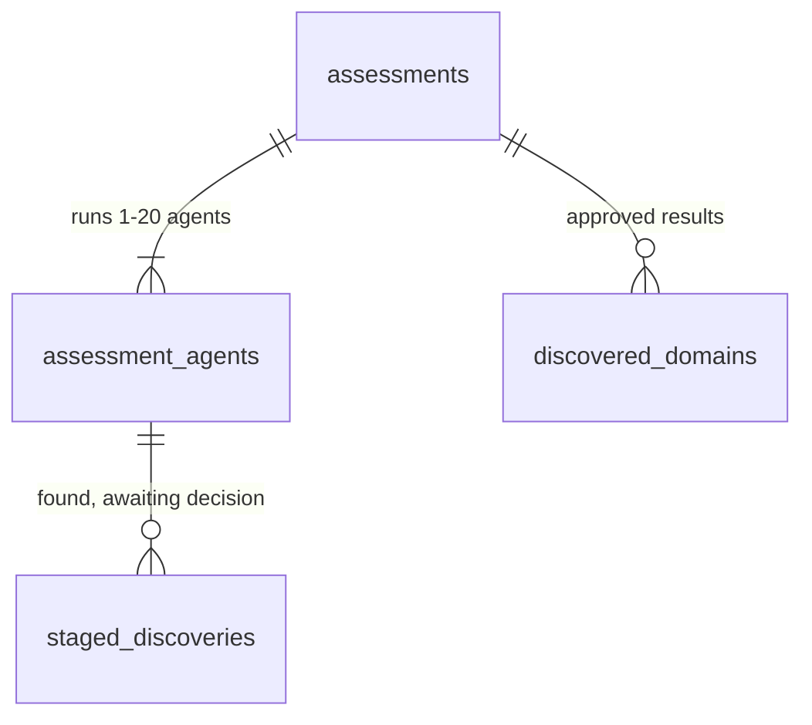

# Tech design

How the system works and why. Each section was settled in discussion; the choice, the rejected
alternative and the reasons are in [`decisions.md`](../decisions.md) (D1–D15).

**Stack:** TypeScript backend (API + worker), Next.js frontend, Temporal, Postgres, local k3s.
**Tooling:** k3d as the local k3s, Task (`Taskfile.yml`) as the task runner.

## The concurrency window (R1)

**In one sentence:** the workflow counts its running agents and starts the next one whenever the count is
below the window.

- **Each agent gets a lane:** the workflow code that looks after one agent, from taking its slot (before the agent exists, while its start may still be retrying) to freeing it (after the agent ended, and was stopped if it stalled). Any ending frees the slot: completed, failed or stopped.
- **The loop:** start lanes while `running < window` and agents are queued; otherwise sleep until something changes (a lane ends, or the window changes).
- **Changing the window:** a message to the running workflow sets the new value. Raising it starts more agents at once. Lowering it only holds back new starts until `running` drops below it; nothing in flight is killed.
- **A slot is taken when we decide to start,** so retries of a failed start happen inside the slot and can't exceed the window.
- **Stalled agents:** an agent whose progress stops moving (60s), or that hits a time ceiling (5 min), is stopped at agent-service first, then its slot is freed, so a stalled agent never pushes us past the window (D7).
- **The first agent starts alone,** so a bad domain gets exactly one start attempt (R5).
- **No polling inside the workflow:** Temporal wakes it on each event (a message, or an agent ending). *(Verified in [spike 01](../../spikes/01-window/README.md).)*

## Agent steps (R2, R4)

**In one sentence:** each agent is three small activities, and none of them returns the discoveries.

| Activity | Does | Returns |
|---|---|---|
| `startAgent` | `POST /scans` with key `<runId>-agent-<n>`. A 503 is retried with backoff; a 422 is not. | the scan id |
| `waitAgent` | Polls `GET /scans/{id}` every ~1s and heartbeats, until the agent ends, stalls or hits its ceiling | status and discovered count |
| `stopAgent` | `POST /scans/{id}/stop`. Safe to repeat. | nothing |

- **The heartbeat is a lease:** if the worker dies, heartbeats stop, and within ~10s Temporal re-runs `waitAgent` on another worker. It polls the same scan id, so the agent is reattached, not restarted.
- **Stall detection (our assumption):** a stalled agent never errors, so `waitAgent` gives up when progress hasn't moved for 60s or the agent has run 5 min (per-run settings, D7). Neither resets after a crash: the ceiling uses agent-service's own start time, and the no-progress clock travels to the re-run in the heartbeat details *(per the docs; to verify)*. Then the lane calls `stopAgent`, marks the agent lost, and frees its slot.
- **Polling is forced:** agent-service has no callback. It's cheap here: polls inside an activity add nothing to the history (spike 01: 78 events for a whole run).

## Results before approval (R4, R6)

**In one sentence:** findings wait in a Postgres staging table, and only an approve turns them into results.

- **When an agent completes,** `waitAgent` writes its findings to `staged_discoveries` (run, agent number, subdomain, risk) and returns only the count. Safe to repeat: a re-run can't add duplicate rows.
- **Aggregate:** one SQL query over the staged rows gives unique subdomains, keeping the most severe risk when agents disagree. It returns a small summary (counts per risk) to the workflow. Order doesn't matter, so a replay can't change it.
- **Approve:** one SQL statement copies the deduplicated set into `discovered_domains`, the results table.
- **Reject or cancel:** deletes the run's staged rows, so nothing from it remains.
- **Approved runs keep their staged rows.** They're the raw material for agent evaluation (which technique finds what, each agent's unique contribution, risk disagreements), and a check: stored results must equal the distinct staged subdomains (R2, R3 proofs).
- **Assumption:** "persisted results" means `discovered_domains`. The staging rows of rejected or cancelled runs are deleted, so nothing from them remains.

## Reading progress (R2, R8)

**In one sentence:** the workflow publishes its state to Postgres as it changes, and the UI reads only Postgres.

- **Before the workflow exists:** the API inserts the run row as `STARTING`, then starts the workflow, so a read right after submit shows "starting", not an error.
- **Per agent:** `waitAgent` updates its agent's row on each poll (status, progress), about 1s fresh.
- **Per run:** the workflow records each phase change through a tiny activity, and only once it's true (e.g. writes "awaiting approval", then starts waiting).
- **While the worker is down:** reads keep working and the numbers freeze, honestly. When it's back, writes resume.
- **Safety net:** if Temporal says the workflow is closed but the database still says live (a bug, or killed by hand), the API shows `FAILED`. `describe` needs no worker.
- **Lag:** milliseconds behind the workflow, below the UI's 1–2s polling.
- **If a write fails:** progress writes are best-effort (logged, never retry the wait; the next poll writes again). Phase, staging and terminal writes are retried, with backoff capped at a few seconds, and the run waits for them, so nothing is announced before it's recorded.
- **If Postgres is down:** the API can't read either and the UI says so. A run can't finish without Postgres anyway (D4).

Verified in [spike 02](../../spikes/02-read-paths/README.md): a query hangs ~29s with no worker; heartbeat progress via `describe` is ~5s stale.

## Cancellation (R7)

**In one sentence:** the API cancels the workflow, and the workflow's cleanup stops every agent it started
before ending `CANCELLED`.

- **Trigger:** the API records "cancel requested" (the UI shows "cancelling"), then cancels the workflow. Temporal wakes it with a cancellation error and cancels its running `waitAgent` steps. The window loop ends, so no queued agent starts.
- **Cleanup can't be cancelled:** it waits for every lane, so an in-flight start finishes and we learn its scan id. Then it stops each started, unfinished agent, deletes the run's staged rows (D4), and writes `CANCELLED`.
- **Who stops the agents:** the worker, through `stopAgent`, run by the cleanup. A 404 means agent-service no longer knows the scan, so there's nothing to stop. Other failures are retried for a bounded time, then the agent is flagged "stop unconfirmed" and the run still ends `CANCELLED`.
- **Worker down at cancel:** Temporal stores the cancel, and the cleanup runs when a worker returns. Until then, agents keep running.
- **When Cancel is allowed:** running, aggregating, awaiting approval. Not once persisting has begun: that's one transaction that either completes or doesn't.
- **Pitfall:** every lane's error must be handled when the lane is created. An unhandled cancellation error fails the workflow step forever, leaving the run stuck live.

Verified in [spike 03](../../spikes/03-cancel/README.md).

## Errors and timeouts (R5)

**In one sentence:** retry what's temporary, write off a bad agent, and end the run only when it can't
produce anything worth reviewing.

| What goes wrong | What we do |
|---|---|
| Start → 503, 429, network error | Retried by Temporal (1s, doubling, capped at 10s) for up to 2 min, then the agent is lost |
| Start → 422 | No retry; the run ends `REJECTED_INPUT` (the first agent starts alone, so one attempt) |
| Start → 400 | No retry; the run ends `FAILED` (our bug) |
| Agent reports `FAILED` | Lost; the run continues |
| Poll → network error | `waitAgent` polls again in 1s (its own loop, not a Temporal retry) |
| Poll → 404 | Lost (agent-service forgot it) |
| Progress unchanged for 60s | Stalled: stopped, then lost |
| Running for 5 min | Ceiling: stopped, then lost |

- **Who retries:** the workflow declares a retry policy per activity, the activity only classifies (throws, or throws "do not retry"), and Temporal does the retrying. The workflow sees one result.
- **Timing values are per-run settings** with these defaults, so longer agents can be configured.
- **The run's end:** no agent completed → `FAILED`. Otherwise it aggregates whatever completed, and the UI shows how many were lost.
- **Normal endings:** `REJECTED_INPUT` and `REJECTED` finish the workflow successfully, carrying that outcome; Temporal shows "failed" only for real breakage.

## Messages into a run

**In one sentence:** user actions reach the workflow as signals, and each is checked for legality by the
UI, the API and the workflow.

| Phase | Approve / Reject | Change window | Cancel |
|---|---|---|---|
| Starting, running agents | no | yes | yes |
| Aggregating | no | no | yes |
| Awaiting approval | yes | no | yes |
| Persisting | no | no | no |
| Terminal | no | no | no |

- **Frontend:** buttons enabled only when the table allows it, and disabled while a request is in flight (R8).
- **API:** checks the table against the read model (D5) and refuses with 409 if not allowed. It records the request ("approval requested"), so the UI shows "approving…" until the backend reports `PERSISTING`, then `COMPLETED`.
- **Workflow:** checks again when the signal arrives and ignores what's illegal; the first decision wins. It is the final judge, since the API's view can be a moment behind (two tabs, approve racing cancel, signals sent straight to Temporal).
- **Worker down:** signals are stored and applied when a worker returns.
- **Cancel** uses Temporal's built-in cancel (D6), but follows the same table.

## Schema (R3)

**In one sentence:** the starter's tables keep their names and columns, and gain the constraints that make
every retried write harmless.

**Origin** in the tables below: `starter` (kept as given), `changed` (kept, with a new type or rule), `new` (ours).

### Enums

Postgres enums sort in declaration order.

| Enum | Values |
|---|---|
| `risk_level` | `LOW`, `MEDIUM`, `HIGH`, `CRITICAL` (so "most severe" is `max(risk)`) |
| `assessment_status` | `STARTING`, `RUNNING`, `AGGREGATING`, `AWAITING_APPROVAL`, `PERSISTING`, `COMPLETED`, `REJECTED`, `REJECTED_INPUT`, `CANCELLED`, `FAILED` |
| `agent_status` | `QUEUED`, `STARTING`, `RUNNING`, `COMPLETED`, `FAILED` (the agent said so), `LOST` (we gave up on it), `STOPPED` (by a cancel) |
| `lost_reason` | `START_FAILED`, `NOT_FOUND`, `NO_PROGRESS`, `CEILING` |
| `decision` | `APPROVE`, `REJECT` |

### `assessments`: one row per run

| Column | Type | Rules | Origin |
|---|---|---|---|
| `id` | `uuid` | primary key; generated by the browser (D12) | starter |
| `target_domain` | `text` | not null | starter |
| `agent_count` | `integer` | not null, 1–20 | changed |
| `window_size` | `integer` | not null, default 2, 1 to `agent_count`; updated when changed | changed |
| `status` | `assessment_status` | not null, default `STARTING` | changed |
| `stall_timeout_s` | `integer` | not null, default 60 | new |
| `max_agent_duration_s` | `integer` | not null, default 300 | new |
| `fail_first_attempts` | `integer` | not null, default 0 (the R3 retry switch) | new |
| `cancel_requested_at` | `timestamptz` | | new |
| `decision` | `decision` | | new |
| `decision_requested_at` | `timestamptz` | | new |
| `unique_domains` | `integer` | written by `aggregate` | new |
| `critical_count`, `high_count`, `medium_count`, `low_count` | `integer` | written by `aggregate` | new |
| `failure_reason` | `text` | | new |
| `created_at`, `updated_at` | `timestamptz` | not null, default `now()` | starter |

Index on `created_at DESC` (starter).

### `assessment_agents`: one row per agent, all created at submit

| Column | Type | Rules | Origin |
|---|---|---|---|
| `id` | `bigserial` | primary key | starter |
| `assessment_id` | `uuid` | not null, → `assessments`, cascade | starter |
| `agent_index` | `integer` | not null, ≥ 0 | starter |
| `technique` | `text` | not null; agent-service's four, rotating by index | changed |
| `scan_id` | `text` | set once the start succeeds | starter |
| `status` | `agent_status` | not null, default `QUEUED` | changed |
| `lost_reason` | `lost_reason` | set with `LOST` | new |
| `stop_confirmed` | `boolean` | set when we stop it; `false` = "stop unconfirmed" (D6) | new |
| `progress` | `real` | not null, default 0, 0–1; written on each poll | new |
| `discovered_count` | `integer` | set on `COMPLETED` | new |
| `worker` | `text` | pod name of the worker handling it | new |
| `started_at`, `finished_at` | `timestamptz` | | starter |
| `updated_at` | `timestamptz` | not null, default `now()` | new |

**`UNIQUE (assessment_id, agent_index)`** (new): the constraint the starter asks about. Index on `assessment_id` (starter).

### `staged_discoveries`: one row per finding, until the decision (new table)

| Column | Type | Rules |
|---|---|---|
| `assessment_id` | `uuid` | not null |
| `agent_index` | `integer` | not null |
| `domain` | `text` | not null |
| `risk` | `risk_level` | not null; as this agent rated it |
| `created_at` | `timestamptz` | not null, default `now()` |

Primary key `(assessment_id, agent_index, domain)`. `(assessment_id, agent_index)` → `assessment_agents`, cascade.

### `discovered_domains`: one row per subdomain per run, written only by approve

| Column | Type | Rules | Origin |
|---|---|---|---|
| `id` | `bigserial` | primary key | starter |
| `assessment_id` | `uuid` | not null, → `assessments`, cascade | starter |
| `domain` | `text` | not null | starter |
| `risk` | `risk_level` | not null; the most severe across agents | changed |
| `created_at` | `timestamptz` | not null, default `now()` | starter |

**`UNIQUE (assessment_id, domain)`** (new): each domain once per run (R3). Index on `assessment_id` (starter).

### Rules for writing

- **Every insert is "insert, or do nothing if it exists",** so a retried activity can't duplicate.
- **Every status update is conditional** ("set `COMPLETED` only if `RUNNING`"), so statuses only move forward, even if a stale worker writes late.
- **At submit,** the API creates the run row (`STARTING`) and all agent rows (`QUEUED`) in one transaction.
- **Database names are `snake_case`;** Prisma maps them to `camelCase` in code.

## UI updates (R8)

**In one sentence:** the run page polls the API with TanStack Query, and stops polling when the run ends.

- **Interval:** 1s while agents run (matching `waitAgent`'s 1s progress writes), 5s while awaiting approval (nothing changes until a person acts), and an immediate refresh after the user's own action.
- **Stops** at any terminal status, and when the page closes: `refetchInterval` returns `false`.
- **Right after submit:** the run and agent rows already exist (D10), so the first poll shows "starting, 0 of N, N queued".
- **Never optimistically terminal:** after Approve returns, the page shows "approving…" until a poll reports `COMPLETED`.
- **Buttons:** enabled per the legality table (D8), and disabled while their request is in flight.
- **When push would pay off:** long idle waits and many viewers. Here, slower polling while awaiting approval covers it.

## Run identity

**In one sentence:** one UUID per run, created by the browser, from which every other id is derived, so the
submit itself is safe to repeat.

- **Derived ids:** workflow `assessment-<uuid>`; agent idempotency keys `<uuid>-agent-<n>`. Stable across retries, crashes and replays (R2, R3).
- **Submit, step by step:** validate the UUID → in one transaction, insert the run (`STARTING`) and its agent rows (`QUEUED`), doing nothing if they exist → start the workflow; "already started" counts as success → reply with the id.
- **What a repeat does:** a double click, or a retry after a crash between the two steps, sends the same id. The save is a no-op, and the start either begins the missing workflow or finds it running.
- **Same id, different parameters:** 409, never the other run.
- **Temporal's "use existing" conflict policy** would return the running workflow instead of an error *(per the docs; check the SDK and server support it when building)*.

## Our HTTP API

**In one sentence:** nine REST endpoints, typed end to end by zod schemas shared with the frontend.

| Method | Path | Purpose | Source |
|---|---|---|---|
| `POST` | `/assessments` | Submit `{ id, domain, agentCount, windowSize }` (+ optional timing settings) | brief: configure a run |
| `GET` | `/assessments/{id}` | Status, counts, window, agent rows, risk summary, `allowedActions` | brief: watch progress |
| `GET` | `/assessments/{id}/domains` | Findings for review (staged, then final), most severe first | brief: review what came back |
| `POST` | `/assessments/{id}/approve` | `202`, or `409` if not allowed now | R6 |
| `POST` | `/assessments/{id}/reject` | same | R6 |
| `POST` | `/assessments/{id}/cancel` | same | R7 |
| `PUT` | `/assessments/{id}/window` | `{ size }` → `202`, `409`, or `400` | R1 |
| `GET` | `/assessments` | Recent runs | ours |
| `GET` | `/healthz` | Health check for k8s | ours |

- **Contracts:** one package of zod schemas, imported by the API (to validate requests) and the frontend (to parse responses). Same idea as Pydantic models on both sides.
- **Keeping them aligned without CI:** `task check` typechecks everything and runs the tests; `task up` runs it first and refuses to deploy on failure, then builds all images from one commit. At runtime, the frontend shows "contract mismatch" rather than render a response that fails its schema.
- **Routing:** the browser talks only to Next.js, which forwards `/api/*` to the API inside the cluster. No CORS, one address, the API stays internal.
- **Validation and limits:** the domain is checked for shape only (non-empty, sane length), never for support. A `.invalid` domain must reach agent-service, get its 422, and end `REJECTED_INPUT` (R5). Agents per run are capped (e.g. 20), and the window must be between 1 and the agent count, so a request can't run up an unbounded bill.
- **Security basics:** parameterized SQL only (Prisma, TypedSQL); credentials stay in the k8s Secret; only the UI is reachable from outside; containers run as non-root with resource limits. No auth: the brief has no users. Next steps would be user accounts and verifying the user may assess the target domain.

## Deployment (R9)

**In one sentence:** `task up` takes an empty k3s cluster to the running stack, and refuses to deploy code
that doesn't typecheck.

**`task up`, in order:**
1. `task check`: typecheck the repo and run the tests; stop on failure (D13).
2. Build five images from one commit, tagged with its git hash: agent-service (given), `api`, `worker`, `web` (the Next.js app) and `migrate`.
3. Load them into the cluster, using the flavour detected from the kubectl context: `k3d image import`, `k3s ctr images import`, or nothing for OrbStack and Rancher Desktop.
4. Apply the namespace, Postgres, Temporal and agent-service; wait until ready.
5. Run the `migrate` Job (`prisma migrate deploy`) and wait for it to complete.
6. Apply `api`, `worker` and `web`; wait for their rollouts.
7. Print how to open the UI (`task open` port-forwards `web` to `localhost:3000`).

- **Worker:** no Service, 2 replicas, resource requests and limits. Liveness: it touches `/tmp/healthy` every 10s while its Temporal connection is running, and an `exec` probe checks the file is fresh.
- **API and web:** `ClusterIP` Services, `/healthz` probes. Only `web` is reached from outside, by port-forward.
- **Config:** environment variables (Temporal address, agent-service URL, `DATABASE_URL` from the given secret).
- **Schema:** Prisma migrations replace the starter's `psql < schema.sql` step.
- **Repo layout:** npm workspaces: `apps/api`, `apps/worker`, `apps/web`, `packages/contracts` (zod), `packages/db` (Prisma), and `k8s/` for our manifests. `starter/` stays untouched.

## How it's verified

**In one sentence:** every requirement has a repeatable proof against the deployed stack, and the
riskiest behaviours have automated tests that gate every deploy.

| Req | Proof (`proofs/`) | Passes when | Automated test |
|---|---|---|---|
| R1 | 6 agents at window 2; a second run raises the window to 4, then lowers it | `maxConcurrent` exactly 2; starts line up with finishes; reaches 4 after the raise; lowering kills nothing | window test; resize test |
| R2 | Delete all worker pods mid-run, then approve | `totalStarted` = N; stored set = the distinct union of the run's agents | replay test |
| R3 | A run with `failFirstAttempts: n` (activities fail after their side effect) | N started, N agent rows, no duplicate domains | database test: approve twice, same rows |
| R4 | Read the run's history from Temporal | Each activity's return and the largest payload, in bytes | — |
| R5 | A `.invalid` domain; a run with `failEveryN` | `REJECTED_INPUT` < 30s, `totalStarted` 0, one start attempt; `COMPLETED` with fewer agents | bad-domain test; error classification |
| R6 | One run approved, one rejected; read mid-flight | `COMPLETED` with rows; `REJECTED`, 0 rows, staging empty; readable with nothing stored | — |
| R7 | Cancel with agents in flight | `CANCELLED`, nothing `RUNNING`, queued agents never started | cancel test |
| R8 | Playwright run with video | No errors after submit; never terminal early; buttons per `allowedActions`; no polling after the end | the same Playwright run |
| R9 | Recreate the k3d cluster, then `task up` | Everything ready; worker without a Service, with probe and resources | — |

- **Workflow tests** use Temporal's test environment: fake activities and skipped time, so a minutes-long run takes milliseconds. They run in `task check`, so they gate every deploy.
- **The retry switch** is a per-run setting: each activity fails its first n attempts right after doing its work, so only a truly idempotent retry passes.
- **Videos** of key flows (submit to approve, cancel mid-flight, window change) are saved in `proofs/videos/` and linked from `NOTES.md`.
